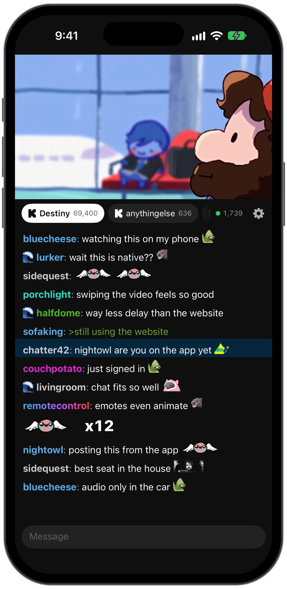
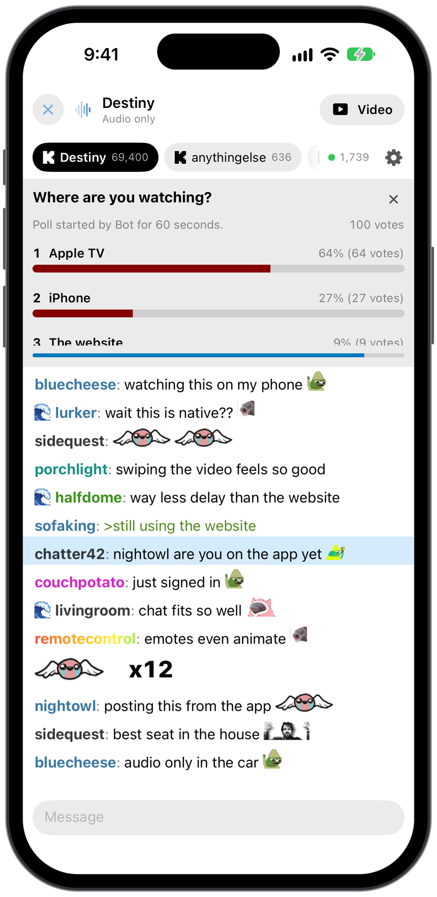
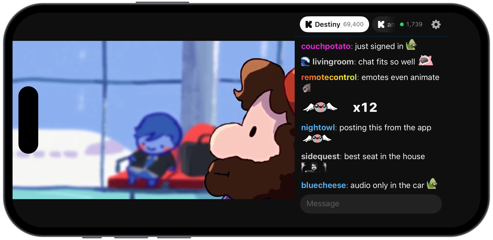

# DGG: Destiny.gg on iPhone

An unofficial fan project, not affiliated with destiny.gg. Still in development, with no builds to install yet. For Apple TV, see [DGGTV](https://github.com/murdrd00/dgg-tv).

  
  

The screenshots are staged with sample chat and viewer counts.

## Signing In

Create a Login Key on destiny.gg under Profile, then Developer, and paste it in Settings. It stays in your iPhone's Keychain and is only sent to destiny.gg. Treat it like a password.

## Development

Shared code is in the `DGGKit` package under `Sources`, and the app is in `App/DGG`. Run `xcodegen` after adding app files. It started as a copy of the shared code from [dgg-tv](https://github.com/murdrd00/dgg-tv), and the two now change separately. [NOTES.md](NOTES.md) has the longer story.
